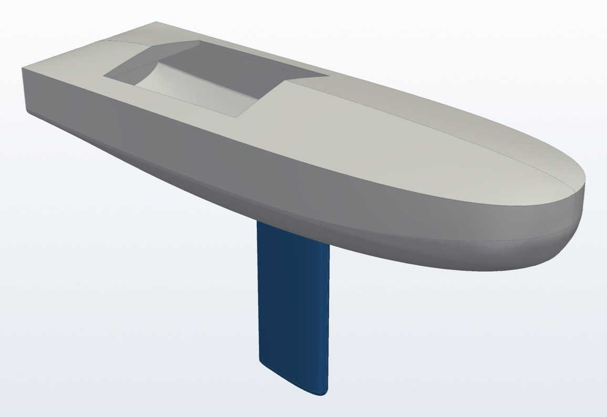
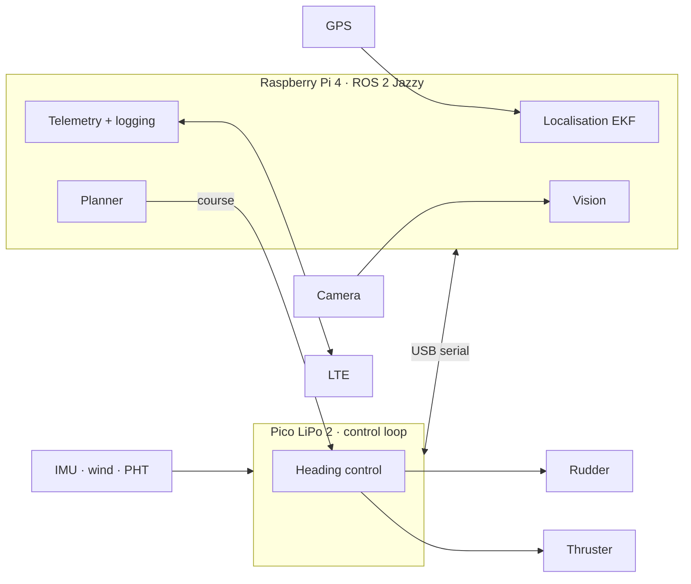
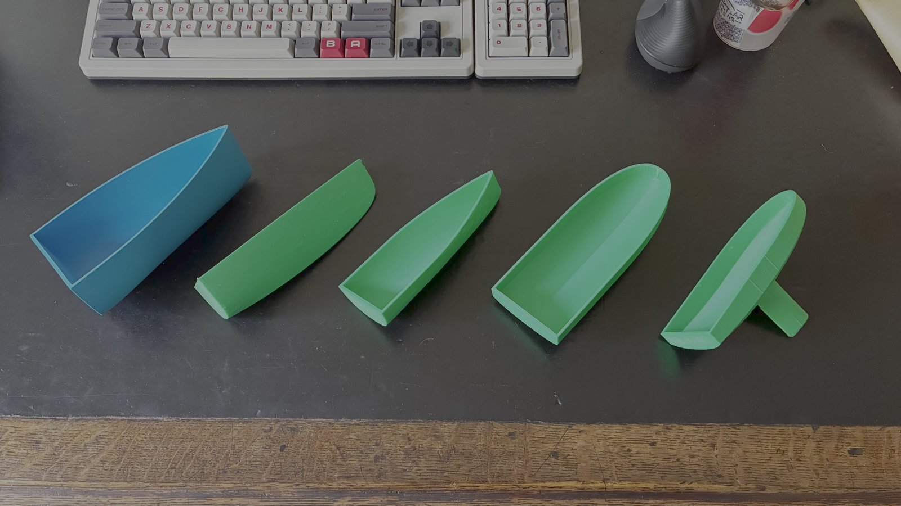
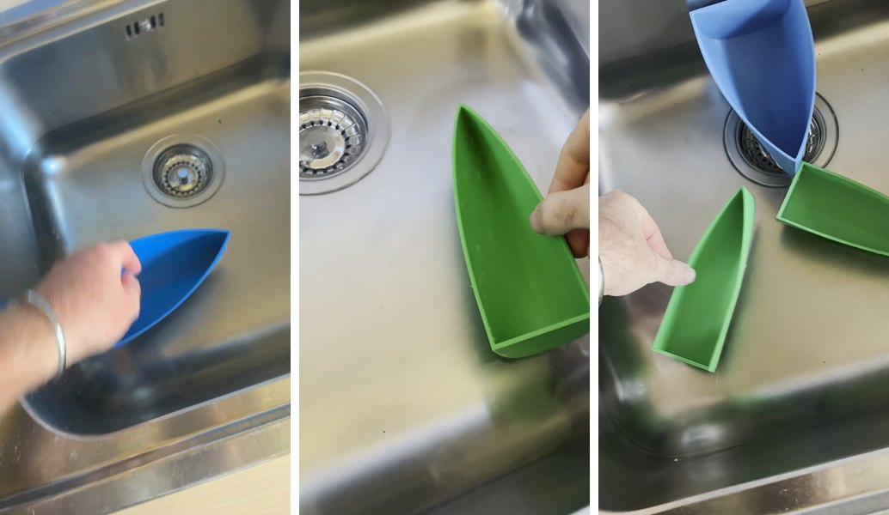
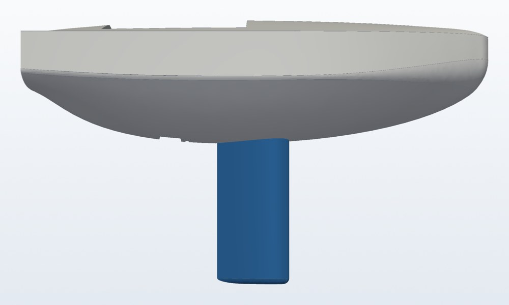
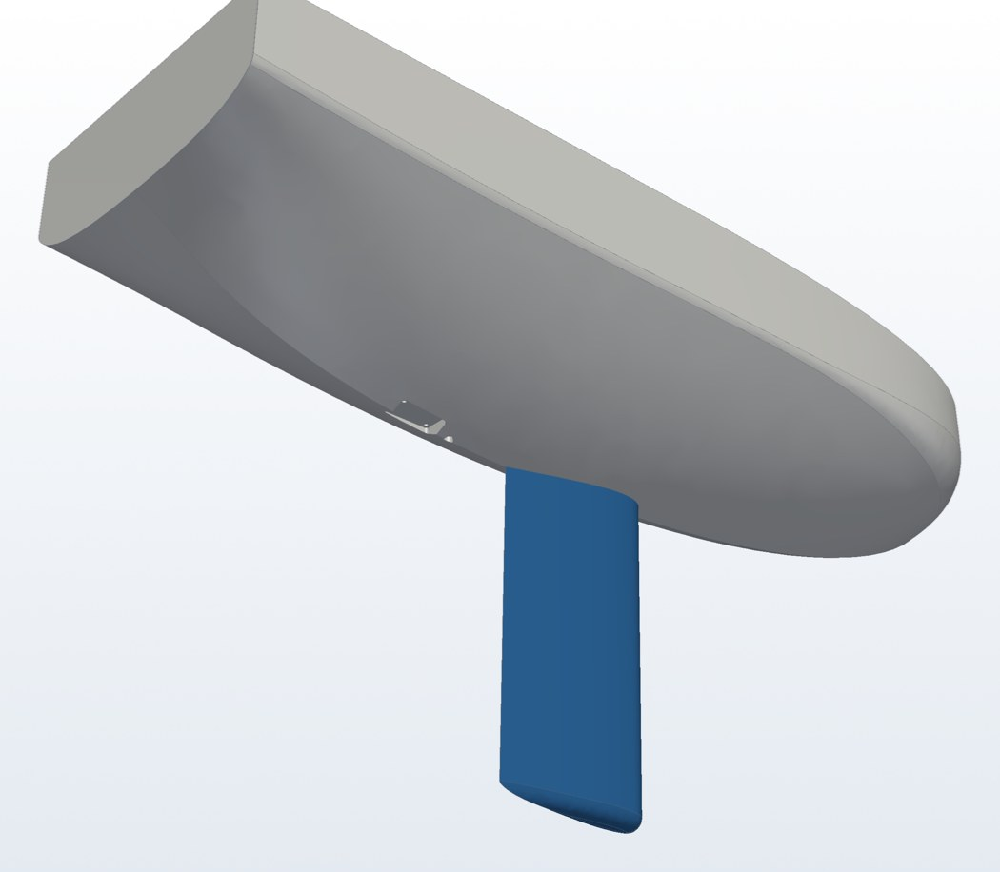
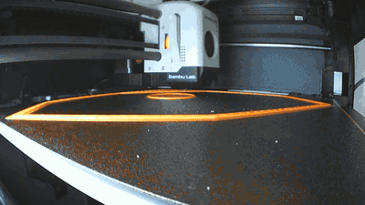
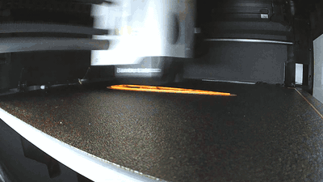

# Autonomous Surface Vessel

A 3D-printed autonomous boat for coastal data collection, running **ROS 2** on a Raspberry Pi with a Pico for real-time control. V1 is motor-driven; a wing sail follows in V2.

  

| | |
|---|---|
| **Hull** | ~750 × 250 mm scow, printed in ABS sections, epoxy-coated |
| **Keel** | Printed fin with ~2 kg lead ballast, bolted through the hull |
| **Compute** | Raspberry Pi 4 (ROS 2 Jazzy) + Pico LiPo 2 (MicroPython) |
| **Sensing** | GPS, 9-DoF IMU, wind, pressure/temp/humidity, camera |
| **Comms & power** | LTE telemetry, 12.8 V 12 Ah LiFePO4 |

## System architecture

The Pico runs the fast control loop and the Pi runs ROS 2: localisation, planning, vision and telemetry.

## Development log

### Sep 2026 · Concept and parts
Chose the hardware and sized the battery from a power budget. → [Parts list](docs/parts-list.md)

### Oct 2026 · Hull shape iterations
Printed scale models and tested each for stability, ending in a scow bow for stability and internal space.

  

   
  Stability tests: <a href="blog/hullv1stabiltytest.MP4">v1</a> · <a href="blog/hullv2stabilitytest.MOV">v2</a> · <a href="blog/hullv3stabilitytest.mov">v3</a>

### Oct 2026 · Full-size hull, keel and mounts
Designed the bolted keel joint, rudder, and the thruster, motor and battery mounts.

  
  

### Oct 2026 · Electronics bring-up
Set up ROS 2 on the Pi and MicroPython on the Pico, and wrote [IMU](code/pico/bno055.py) and [PHT](code/pico/ms8607.py) drivers from the datasheets. → [Pi setup](docs/pi-setup.md) · [Pico setup](docs/pico-setup.md)

### Nov 2026 · Hull top and first prints
Finalised dimensions, added the hatch and section joints, and printed the bow and keel.

  
  

<!--
Template for new entries:

### Mon YYYY · Title
One or two sentences.

  

-->

## Roadmap

**V1: motor-driven**
- [x] Hull, keel and rudder CAD
- [x] Pi + ROS 2 and Pico bring-up
- [ ] Print, bond and epoxy the hull, pour keel ballast
- [ ] Pico ↔ Pi bridge publishing sensor topics
- [ ] Rudder and thruster control
- [ ] First float and trials
- [ ] Autonomous waypoint missions

**V2: sailing**
- [ ] Wing sail and sail control
- [ ] Wind-aware route planning

## Docs

[Parts list & power budget](docs/parts-list.md) · [Software stack](docs/software.md) · [Assembly notes](docs/assembly.md) · [Pi setup](docs/pi-setup.md) · [Pico setup](docs/pico-setup.md)
