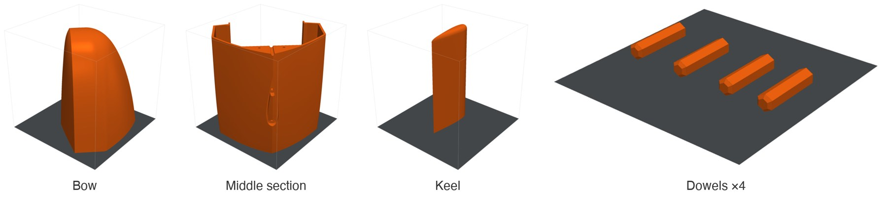

# Printing

All structural parts are printed in ABS on a Bambu Lab P1S. ABS can be solvent-welded with acetone, survives a hot day in the sun, and takes an epoxy coat well. The slicer project is [cad/ABS boat settings.3mf](../cad/ABS%20boat%20settings.3mf) (Bambu Studio).

The hull is too long for the 256 mm build volume, so it is split into sections that print standing up and are joined with printed dowels, then bonded with acetone.

| Plate | Part |
|---|---|
| 1 | Bow section |
| 2 | Dowels ×4 |
| 3 | Middle section |
| 4 | Keel |

## Settings

| Setting | Value |
|---|---|
| Printer | Bambu Lab P1S, 0.4 mm nozzle, textured PEI plate |
| Filament | Bambu ABS, orange (#FF6A13), flow ratio 0.95 |
| Nozzle | 260 °C (270 °C first layer) |
| Bed | 100 °C |
| Layer height | 0.20 mm |
| Walls | 2 |
| Top / bottom shells | 5 / 3 layers |
| Infill | 15 % grid |
| Supports | Tree (auto) |
| Brim | 5 mm, inner and outer |
| Part cooling fan | 10 %, off for the first 3 layers (40 % on overhangs) |
| Exhaust fan | 70 % during and after the print |
| Seam | Aligned |
| Elephant foot compensation | 0.15 mm |

Low fan speed and a closed enclosure keep the layers hot so they bond well and the tall parts don't warp or crack between layers. The brim holds the corners down on the long, thin footprints.

## After printing

1. Dry-fit the sections on the dowels.
2. Bond with acetone (or ABS slurry: ABS scraps dissolved in acetone).
3. Coat the hull and keel in epoxy to seal the layer lines.

The images on this page are generated from the 3MF by [tools/render_cad.py](../tools/render_cad.py).
